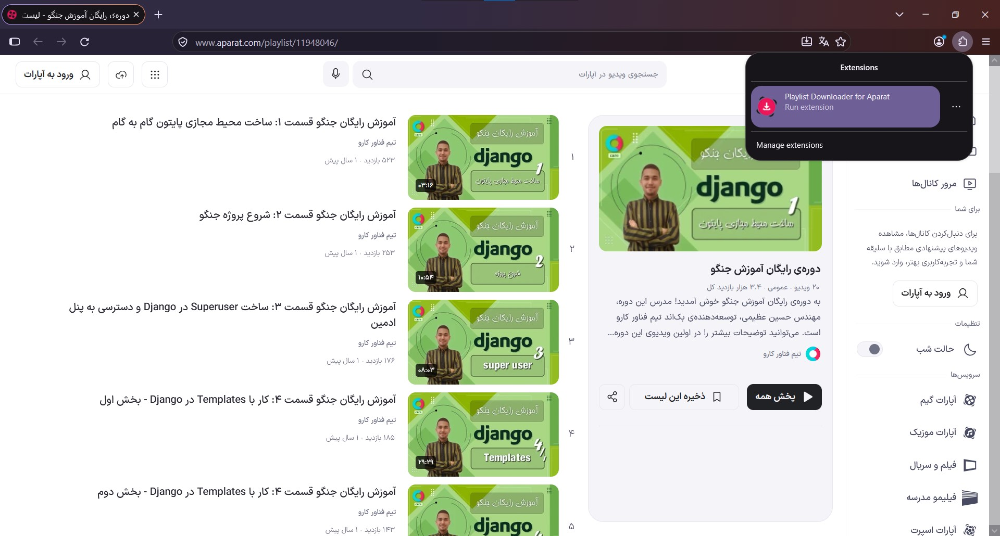
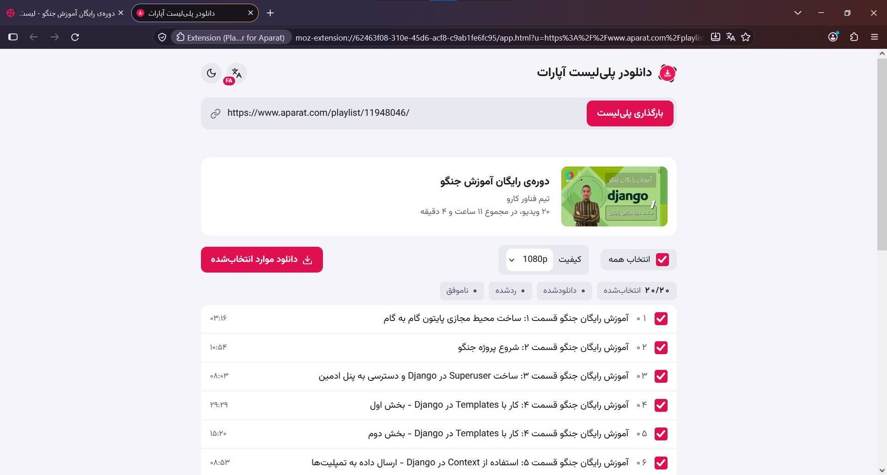

# Playlist Downloader for Aparat

Available for Firefox 140+, Google Chrome 123+ and Microsoft Edge 123+.

Downloads every video of an Aparat playlist, in playlist order, into
`Downloads/Aparat/<playlist title>/NN - <video title>.mp4` (NN is zero-padded: 2 digits, 3 from 100 videos, 4 from 1000).

## Screenshots


<br><br><br><br>


## Install in Firefox
Quick test (removed when Firefox restarts):
1. Open `about:debugging#/runtime/this-firefox`.
2. Click **Load Temporary Add-on** and pick `manifest.json` from the source folder or the generated `dist/firefox` folder. A Firefox release ZIP also works.

## Install in Chrome or Edge

Generate the browser folders with Node.js 20 or newer:

```sh
npm run build
```

This single command creates unpacked folders and versioned ZIP files for **all three browsers**, plus `dist/index.html`, a local build viewer with download links and installation instructions.
The terminal also lists every output path. No dependency installation, Python, or external archiver is required.

To build everything and immediately open the viewer in your default browser:

```sh
npm run build:open
```

1. Open `chrome://extensions` in Chrome or `edge://extensions` in Edge.
2. Enable **Developer mode**.
3. Click **Load unpacked** and select `dist/chrome` or `dist/edge`, respectively.

If using a release ZIP, extract it first and select the extracted folder containing `manifest.json`.
Keep that folder in place while the extension is installed. After updating the files, click **Reload** on the extensions page.
The source folder's root manifest is for Firefox; Chrome and Edge must use their generated folders.

## Use
Click the toolbar icon (on an Aparat playlist page the link is filled in for you), or paste a link such as
`https://www.aparat.com/playlist/1301084/`, then **Load playlist** and **Download selected**.
Keep the tab open while it runs. **Stop** cancels pending link requests, retry waits and active downloads.
Clicking **Download selected** again retries unfinished videos; completed files and videos with downloads disabled are skipped.
The link field accepts Aparat playlist URLs, video URLs with a `playlist` query parameter, or a numeric playlist ID (including Persian digits).

## Languages
English and Persian (RTL). The extension starts in Persian. The globe button next to the theme button switches language, and the choice is remembered from then on.
- UI strings: `locales/en.json`, `locales/fa.json` (flat key -> text, `{placeholders}`, plurals as `key.one` / `key.other`).
- Store listing name/description/tooltip: `_locales/<code>/messages.json`.
- To add a language: add `locales/<code>.json`, `_locales/<code>/messages.json`, and one entry in `LANGS` in `i18n.js`
  (set `dir` to `rtl` or `ltr`, and `digits` to its digit characters, or `null`).
  Missing keys fall back to English. Clicking the globe cycles through the languages in `LANGS`.

## Font
`fonts/Vazirmatn-VariableFont_wght.ttf` (Vazirmatn, SIL Open Font License 1.1, see `fonts/OFL.txt`).
One variable file covers all weights. Replace it with your own copy using the same file name if you like.

## Icon
Replace the PNGs in `icons/` with your own, keeping the names: `icon-16.png`, `icon-32.png`, `icon-48.png`, `icon-128.png`
(Chrome does not accept SVG for extension icons). Then reload the add-on.
UI icons are from Lucide (https://lucide.dev, ISC license), inlined in `app.html`.

## What it does and doesn't do
- Permissions: `downloads`, and API access to `www.aparat.com`. Video files and thumbnails are fetched from Aparat's CDN hosts. No analytics or telemetry is included.
- Skips videos whose uploader disabled downloads.
- Download links are signed and expire within hours, so each one is requested just before its download.
- Two videos download at a time. Aparat rate-limits its API, so don't raise this much.
- If Aparat returns fewer videos than the playlist's reported count, the app shows a warning; only returned videos are available.
- API requests time out after 30 seconds. Video failures are retried up to three times; Stop also interrupts the retry delay.

## Development checks

No runtime dependencies or bundler are required. With Node.js 20 or newer, run `npm test`.
The tests cover URL and response parsing, file names, quality selection, request cancellation and timeouts,
download event races, queue concurrency and selection state under both `browser` and `chrome` namespaces,
language switching, toolbar actions, and generated browser packages.
Browser download APIs are simulated in these tests; validate real downloads by loading the appropriate browser build as described above.

`npm run build` creates `dist/firefox`, `dist/chrome` and `dist/edge` with only runtime files, assets and a browser-specific manifest, alongside `playlist-downloader-aparat-<browser>-<version>.zip` files and `dist/index.html`.
Use `npm run build:firefox`, `npm run build:chrome` or `npm run build:edge` to generate one target.
Firefox keeps its background scripts and Gecko settings; Chrome and Edge use a Manifest V3 service worker.
The minimum Chromium version reflects the UI's use of the `light-dark()` CSS function.
ZIPs are generated automatically with `manifest.json` at the archive root. Repeated builds of unchanged source generate identical ZIPs.
Publishing through browser stores is a separate step.
